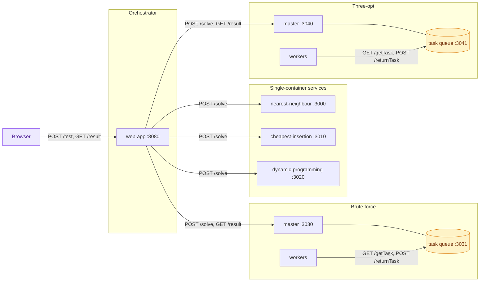
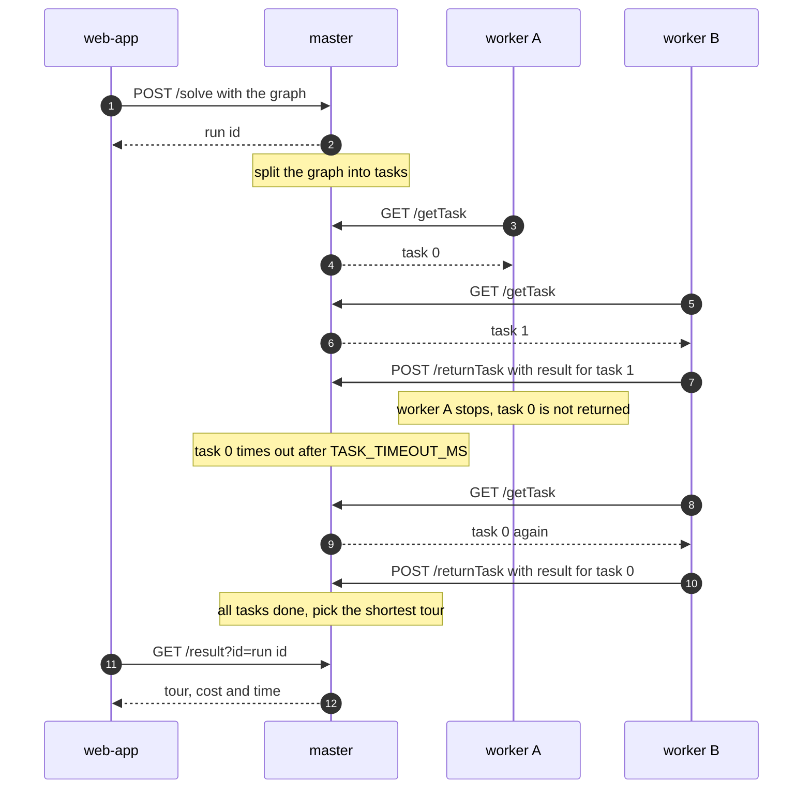

# Containerised Approach to NP-Complete Problems

This project solves the travelling salesman problem with five algorithms, each running in its own container. Two of the algorithms, brute force and three-opt, split their work across worker containers. It started as a university project.

## Project parts

Part one is `shared/algorithms`. It holds the five algorithms as plain JavaScript, with no server around them.

Part two is the services. Each algorithm gets a small Express service and a Dockerfile. The two multi-container algorithms also get a worker. A web app sends graphs to the services and shows the tours. A Helm chart deploys everything to Kubernetes.

## Architecture

The web app is the only entry point. It calls the three single-container services directly. For brute force and three-opt it calls a master, which splits the graph into tasks. Workers poll the master's queue port for tasks and return their results.



A multi-container run looks like this. If a worker does not return a task within `TASK_TIMEOUT_MS` (five minutes by default), the master gives the task to the next worker that asks.



## Algorithms

| Algorithm | Kind | Containers | Port |
|-----------|------|------------|------|
| Nearest neighbour | Heuristic | Single | 3000 |
| Cheapest insertion | Heuristic | Single | 3010 |
| Dynamic programming | Exact | Single | 3020 |
| Brute force | Exact | Master and workers | 3030 (queue 3031) |
| Three-opt | Heuristic | Master and workers | 3040 (queue 3041) |

The web app listens on port 8080. Each service has its own README with the API and environment variables.

## Running it

Prerequisites are Node 22 (see `.nvmrc`) and Docker. For Kubernetes you also need `kubectl`, Helm and, to run it locally, k3d.

### Docker Compose

```bash
docker compose up --build
```

The web app is then at `http://localhost:8080`. Set `WEB_PORT` to use another port. Compose starts one worker for each master. To start more:

```bash
docker compose up --build --scale brute-force-worker=4 --scale three-opt-worker=4
```

### Kubernetes on k3d

```bash
scripts/k3d-up.sh      # creates the k3d cluster "tsp", builds and imports the images, runs helm
scripts/k3d-smoke.sh   # one solve per algorithm through the web app
scripts/k3d-down.sh    # deletes the cluster
```

`SKIP_BUILD=1 scripts/k3d-up.sh` imports images that already exist locally. The number of workers is `masters.<name>.workers` in `deploy/helm/tsp/values.yaml`.

### Any other cluster

```bash
helm install tsp deploy/helm/tsp
```

The images on `ghcr.io/jadamsx/containerised-tsp` are private. Either create an image pull secret and pass it with the chart value `imagePullSecrets`, or build the images yourself and set `image.repository` and `image.tag`.

## Tests

Each service has integration tests that run the algorithm directly, and API tests that need the service running. Use `npm ci` first.

```bash
cd backend/single-container/nearest-neighbour
npm test                   # integration tests
node src/server.js &       # start the service
npm run test:api
```

The multi-container services also need a worker for the API tests, so start `node src/worker.js &` as well. The web app has `npm run lint` and no tests yet.

CI (`.github/workflows/ci.yaml`) runs on every pull request and push to `main`:

- lint for the web app
- integration and API tests for each of the five services
- a Docker build for each of the six images, pushed to ghcr on `main`
- on pull requests, a deploy to k3d with `scripts/k3d-up.sh` and a solve through the web app with `scripts/k3d-smoke.sh`

## Repository layout

```
backend/
  single-container/   nearest-neighbour, cheapest-insertion, dynamic-programming
  multi-container/    brute-force, three-opt (master and worker in one image)
frontend/web-app/     React interface and the Express server that calls the services
shared/algorithms/    the five algorithms on their own
shared/graphs/        test graphs
deploy/helm/tsp/      Helm chart
scripts/              k3d up, smoke and down
.github/workflows/    CI and release
```

## Future work

- [#21](https://github.com/jadamsx/containerised-tsp/issues/21) Property-based tests for the algorithms
- [#22](https://github.com/jadamsx/containerised-tsp/issues/22) Mutation testing to check the tests catch real bugs
- [#23](https://github.com/jadamsx/containerised-tsp/issues/23) Fault tests for the master and workers
- [#24](https://github.com/jadamsx/containerised-tsp/issues/24) Tests for the web app
- [#25](https://github.com/jadamsx/containerised-tsp/issues/25) Scale workers automatically on queue length
